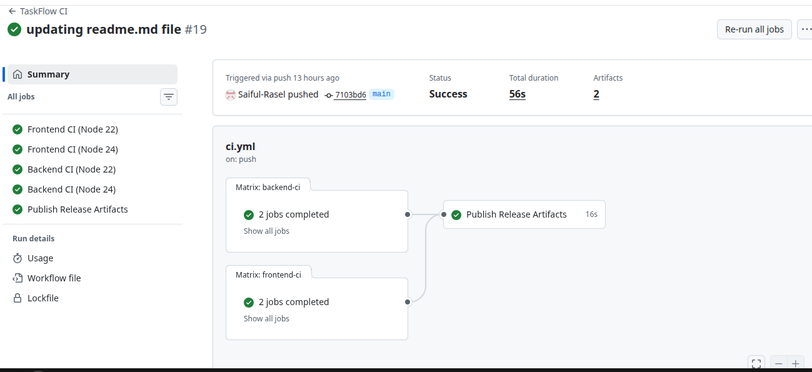
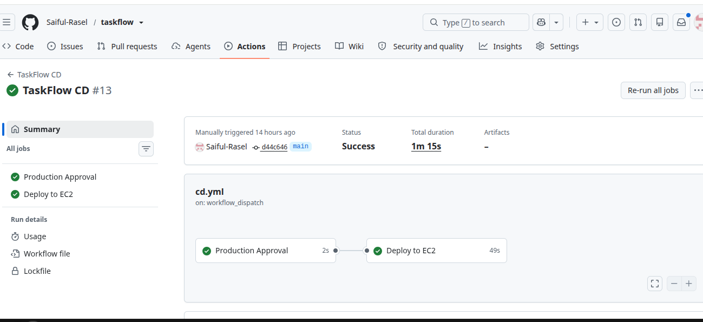
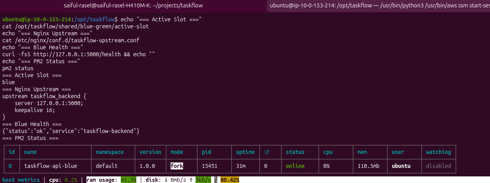
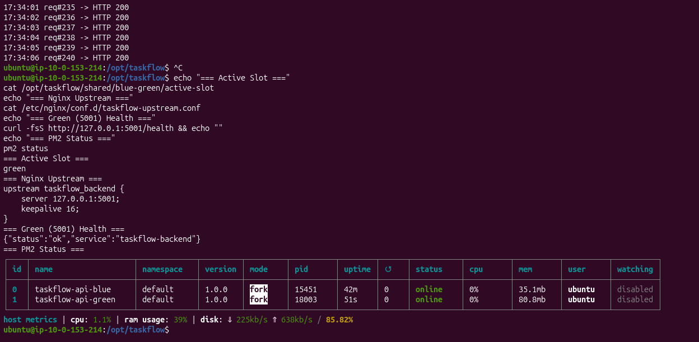
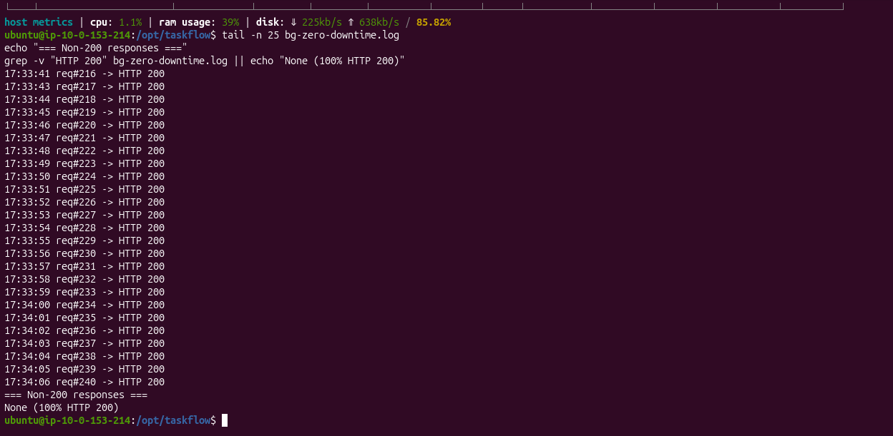
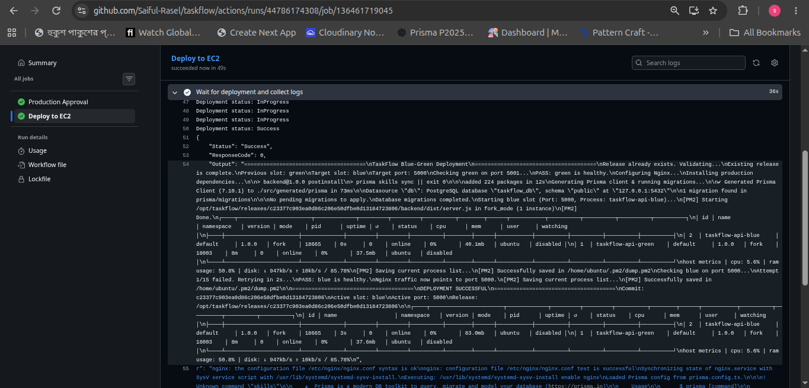
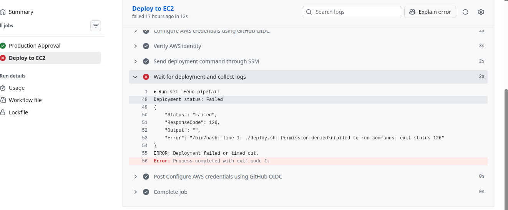

# ShopNest — Automated CI/CD & Blue-Green Deployment


**Production-Ready Three-Tier Application | AWS | GitHub Actions | Docker | Nginx | Blue-Green Deployment**


ShopNest is a three-tier web application deployed on AWS EC2 using an automated GitHub Actions CI/CD pipeline. It implements Blue-Green deployment to minimize downtime, automated health checks, release traceability, and automatic rollback.

**Live Application:** http://taskflow-alb-2057187704.ap-south-1.elb.amazonaws.com/

**Deployment Strategy:** Blue-Green Deployment  
**Cloud Provider:** AWS  
**CI/CD Platform:** GitHub Actions  
**Application Entry Point:** AWS Application Load Balancer  
**Reverse Proxy:** Nginx  
**Process Manager:** PM2  
**Backend Slots:** Blue (`127.0.0.1:5000`) and Green (`127.0.0.1:5001`)  
**Database:** Relational Database (PostgreSQL, if matching the deployed environment)

---

# Table of Contents

1. [Project Overview](#1-project-overview)
2. [CI/CD Concepts — Part A](#2-cicd-concepts--part-a)
3. [System Architecture](#3-system-architecture)
4. [CI Pipeline — Part B](#4-ci-pipeline--part-b)
5. [Workflow Architecture — Part C](#5-workflow-architecture--part-c)
6. [Secrets & Configuration — Part D](#6-secrets--configuration--part-d)
7. [AWS EC2 Deployment — Part E](#7-aws-ec2-deployment--part-e)
8. [Zero-Downtime Blue-Green Deployment — Part F](#8-zero-downtime-blue-green-deployment--part-f)
9. [Health Checks & Rollback — Part G](#9-health-checks--rollback--part-g)
10. [Debugging & GitHub Copilot — Part H](#10-debugging--github-copilot--part-h)
11. [Project Structure](#11-project-structure)
12. [Installation & Setup](#12-installation--setup)
13. [Deployment Verification](#13-deployment-verification)
14. [Screenshots & Evidence](#14-screenshots--evidence)
15. [Security Best Practices](#15-security-best-practices)
16. [Troubleshooting](#16-troubleshooting)
17. [Limitations & Future Improvements](#17-limitations--future-improvements)
18. [Useful Resources](#18-useful-resources)
19. [Author](#19-author)

---

# 1. Project Overview

## The Problem

Before implementing CI/CD, ShopNest used a manual deployment process.

Developers had to:

1. SSH into the production EC2 instance.
2. Pull the latest source code.
3. Install dependencies.
4. Build the frontend and backend.
5. Restart application services.
6. Manually verify whether the application was working.

This process introduced three major production incidents:

| Incident | Business Impact |
|---|---|
| Broken builds deployed without testing | Production bugs |
| Approximately 10 minutes of downtime per deployment | Poor user experience |
| No reliable release history or rollback mechanism | 2 hours to recover |
| Credentials committed to Git history | Security risk |

## Our Solution

ShopNest introduces an automated deployment platform using GitHub Actions and AWS.

Key capabilities:

- Automated frontend and backend CI.
- Automated linting, testing, and builds.
- Separate CI and CD workflows.
- Build artifact management.
- AWS authentication using GitHub OIDC.
- Secure environment-specific configuration.
- Automated deployment to EC2.
- Blue-Green deployment using two application slots.
- Nginx traffic switching.
- Automated health verification.
- Automatic rollback on failed deployment.
- Manual rollback to previous releases.
- Deployment traceability using Git commit SHA.

---

# 2. CI/CD Concepts — Part A

## 2.1 What is Continuous Integration?

Continuous Integration (CI) is a development practice where developers frequently integrate their code into a shared repository.

Every push or pull request automatically triggers:

- Dependency installation.
- Code linting.
- Automated tests.
- Application builds.

The objective is to detect problems before code reaches production.

**ShopNest implementation:**

GitHub Actions automatically validates frontend and backend changes whenever developers push code or open pull requests against `main`.

## 2.2 What is Continuous Delivery?

Continuous Delivery ensures that every change passing automated validation is packaged and kept ready for production deployment.

The production release can require manual approval.

**ShopNest implementation:**

After successful CI and staging deployment, the production deployment becomes available for approval through GitHub Environments.

## 2.3 What is Continuous Deployment?

Continuous Deployment automatically deploys every change that passes all required automated checks to production without requiring manual approval.

## 2.4 Differences

| Feature | CI | Continuous Delivery | Continuous Deployment |
|---|---|---|---|
| Automated testing | Yes | Yes | Yes |
| Automated build | Yes | Yes | Yes |
| Deployment preparation | Optional | Yes | Yes |
| Production approval | Not applicable | Can be required | Not required |
| Automatic production deployment | No | Not necessarily | Yes |

## 2.5 How ShopNest Fixes the Incidents

| Previous Incident | Implemented Solution |
|---|---|
| Broken builds reached production | CI validates lint, tests, and builds before merging |
| Deployment caused downtime | Blue-Green deployment with controlled Nginx upstream switching |
| Recovery took two hours | Release tracking and automated/manual rollback |
| Credentials exposed in Git | GitHub Secrets, Variables, OIDC, and secure EC2 configuration |

## 2.6 Chosen Approach

ShopNest follows a **Continuous Delivery** approach with automated CI and staging deployment, followed by controlled production promotion.

This approach provides:

- Fast feedback for developers.
- Consistent deployment artifacts.
- Controlled production releases.
- Human approval before production changes.
- Better production reliability.

---

# 3. System Architecture

## 3.1 Three-Tier Architecture

The application contains three logical tiers.

### Presentation Tier

Responsibilities:

- Displays the web application.
- Handles user interactions.
- Communicates with the backend REST API.

Technology: React / Vite / TypeScript.

### Application Tier

Responsibilities:

- Handles API requests.
- Implements business logic.
- Validates incoming requests.
- Communicates with the database.

Technology: Node.js / Express or the actual backend framework used by this repository.

### Data Tier

Responsibilities:

- Stores application data.
- Manages relational records.
- Provides persistent storage.
- Supports database transactions.

Technology: PostgreSQL.

The database must remain private and must not accept public internet connections.

## 3.2 AWS Architecture

```text
                    Developer
                        |
                        |
                  GitHub Repository
                        |
                Pull Request / Push
                        |
                        v
                GitHub Actions
                        |
              +---------+---------+
              |                   |
              v                   v
          CI Workflow         CD Workflow
              |                   |
        Frontend CI          Build Artifacts
        Backend CI                |
        Runtime Matrix             |
        Automated Tests            |
        Build Verification        |
              |                   |
              +---------+---------+
                        |
                   CI Success
                        |
                        v
                Staging Deployment
                        |
                Production Approval
                        |
                        v
                Production Deployment
                        |
                        v
              AWS Application Load
                    Balancer
                        |
                        v
                 Nginx Reverse Proxy
                        |
                 Active Application
                   +---------+
                   |         |
                   v         v
                BLUE       GREEN
              Port 5000   Port 5001
                   |         |
                   +----+----+
                        |
                        v
                  Backend API
                        |
                        v
                 PostgreSQL DB
                  Private Tier
```

## 3.3 Deployment Architecture

The deployment server maintains two application slots.

| Slot | Local Address | Purpose |
|---|---|---|
| Blue | `127.0.0.1:5000` | One application release |
| Green | `127.0.0.1:5001` | Alternate application release |

Nginx routes incoming traffic to the active backend slot.

For example:

```text
Internet
   |
   v
AWS ALB
   |
   v
Nginx :80
   |
   v
Active upstream
   |
   +---- Blue :5000
   |
   +---- Green :5001
```

Only one slot receives normal production traffic at a time.

The inactive slot is prepared and health-checked before traffic switching.

---

# 4. CI Pipeline — Part B

## 4.1 CI Objectives

The CI workflow automatically executes when:

- Code is pushed to `main`.
- A pull request targets `main`.

Both frontend and backend must pass their independent validation stages.

## 4.2 Frontend CI

Frontend CI performs:

1. Checkout source code.
2. Configure Node.js.
3. Install dependencies using `npm ci`.
4. Run ESLint.
5. Execute automated tests.
6. Build the frontend.
7. Upload the generated build artifact.

Example commands:

```bash
npm ci
npm run lint
npm test
npm run build
```

## 4.3 Backend CI

Backend CI performs:

1. Checkout source code.
2. Configure Node.js.
3. Install dependencies.
4. Run linting.
5. Execute backend tests.
6. Build the backend.
7. Upload the build artifact.

Example commands:

```bash
npm ci
npm run lint
npm test
npm run build
```

## 4.4 Runtime Matrix Testing

The backend is tested against multiple Node.js versions to identify runtime compatibility issues.

Example:

```yaml
strategy:
  fail-fast: false
  matrix:
    node-version: [20, 22]
```

This allows independent jobs to test the application against multiple supported runtimes.

## 4.5 Pull Request Protection

The `main` branch must be protected.

Required settings:

- Require a pull request before merging.
- Require CI status checks to pass.
- Require branches to be up to date, if enabled.
- Restrict direct pushes where appropriate.

Required status checks must match the actual job names in the CI workflow.

**GitHub configuration:**

Repository → Settings → Branches / Rulesets → Main branch rules.

---

# 5. Workflow Architecture — Part C

## 5.1 Separate Workflows

ShopNest uses separate CI and CD workflows.

| Workflow | Responsibility |
|---|---|
| `ci.yml` | Validate frontend and backend and push into aws s3 bucket|
| `cd.yml` | first check oidc connection then login server ssm role and then download s3 bucket commit sha and install all dependencies and project structure |
| `rollback.yml` | Manually restore a previous release, if implemented |

## 5.2 CI Workflow Jobs

```text
CI Workflow
    |
    +----------------------+
    |                      |
    v                      v
Frontend CI            Backend CI
    |                      |
    v                      v
Lint                   Lint
    |                      |
    v                      v
Tests                  Tests
    |                      |
    v                      v
Build                  Build
    |                      |
    v                      v
Upload Artifact        Upload Artifact
```

Frontend and backend CI execute in parallel because they are independently testable.

## 5.3 CD Workflow Jobs

```text
CD Workflow
     |
     v
Validate CI Result
     |
     v
Download Artifacts
     |
     v
Deploy to Staging
     |
     v
Staging Health Check
     |
     v
Production Approval
     |
     v
Deploy to Production
     |
     v
Production Health Check
     |
     +----------+
     |          |
     v          v
   Healthy    Unhealthy
     |          |
     v          v
  Success    Automatic Rollback
```

## 5.4 Artifact Management

CI should produce versioned build artifacts.

Each deployment should be associated with:

- Git commit SHA.
- Workflow run ID.
- Artifact name.
- Build timestamp.
- Deployment environment.

Example release identifier:

```bash
RELEASE_ID="${GITHUB_SHA}"
```

Build artifacts should be passed between jobs using GitHub Actions artifact upload/download actions.

The CD workflow should deploy the validated artifact rather than rebuilding different source code independently.

## 5.5 Runner Strategy

| Job | Runner |
|---|---|
| Frontend CI | GitHub-hosted Ubuntu runner |
| Backend CI | GitHub-hosted Ubuntu runner |
| Runtime matrix | GitHub-hosted Ubuntu runner |
| Artifact management | GitHub-hosted Ubuntu runner |
| Deployment | GitHub-hosted Ubuntu runner or securely configured self-hosted runner |

Use GitHub-hosted runners for normal CI unless there is a specific requirement for a self-hosted runner.

---

# 6. Secrets & Configuration — Part D

## 6.1 Security Strategy

ShopNest does not store credentials inside application source code or workflow files.

Sensitive configuration is managed through:

- GitHub Actions Secrets.
- GitHub Actions Variables.
- GitHub Environments.
- AWS IAM OIDC.
- EC2 environment configuration.

## 6.2 GitHub Secrets

Document the actual secrets configured in the repository.

| Secret | Purpose |
|---|---|
| `AWS_ROLE_ARN` | IAM role assumed through GitHub OIDC, if configured as a secret |
| `EC2_HOST` | Deployment server address, if stored as a secret |
| `EC2_SSH_KEY` | SSH private key, only if SSH-key authentication is used |
| `DB_PASSWORD` | Database password, if required by the workflow |
| `STAGING_DB_PASSWORD` | Staging database password, if required |
| `PRODUCTION_DB_PASSWORD` | Production database password, if required |G_DB_PASSWORD` | Staging database password, if required |
| `PRODUCTION_DB_PASSWORD` | Production database password, if required |

Remove entries that are not actually used.

Prefer AWS OIDC over long-lived AWS access keys.

## 6.3 GitHub Variables

| Variable | Purpose |
|---|---|
| `AWS_REGION` | AWS deployment region |
| `ECR_REPOSITORY` | Container image repository, if using ECR |
| `APP_NAME` | Application identifier |
| `STAGING_HOST` | Staging deployment target, if configured |
| `PRODUCTION_HOST` | Production deployment target, if configured |

Remove unused variables from this list.

## 6.4 Environment Separation

ShopNest uses separate environments:

**Staging**

- Used for testing new releases.
- Receives automatic deployment after successful CI.
- Uses staging-specific configuration.
- Must not share production credentials unnecessarily.

**Production**

- Uses production-specific configuration.
- Requires manual approval through GitHub Environment protection rules.
- Deploys only validated artifacts.
- Runs production health checks.

GitHub configuration:

Repository → Settings → Environments.

Create:

```text
staging
production
```

Configure production required reviewers if supported by the repository's plan and environment settings.

## 6.5 AWS OIDC Authentication

GitHub Actions should assume an AWS IAM role through OpenID Connect.

Authentication flow:

```text
GitHub Actions
      |
      v
GitHub OIDC Token
      |
      v
AWS STS
      |
      v
IAM Role Trust Policy
      |
      v
Temporary AWS Credentials
      |
      v
AWS Resources
```

This avoids storing permanent AWS access keys in GitHub.

The IAM trust policy must restrict access to the intended repository and branch or GitHub Environment subject.

---

# 7. AWS EC2 Deployment — Part E

## 7.1 AWS Infrastructure

The production infrastructure contains:

| Component | Responsibility |
|---|---|
| VPC | Network isolation |
| Public Subnet | Public-facing infrastructure |
| Private Subnet | Private application/database resources, where configured |
| Application Load Balancer | Public application entry point |
| EC2 | Application deployment host |
| Nginx | Reverse proxy |
| PM2 | Backend process management |
| PostgreSQL | Relational database |

Actual subnet placement and EC2 security-group configuration should match the deployed AWS environment.

## 7.2 Security Groups

**Load Balancer Security Group**

- Allow HTTP 80 from the internet.
- Allow HTTPS 443 if TLS is configured.
- Forward traffic to the application target group.

**EC2 Security Group**

- Allow application traffic only from the ALB security group.
- Allow administration through the configured secure access method.
- Do not expose database ports publicly.

**Database Security Group**

- Allow PostgreSQL traffic only from the application security group.
- Never allow PostgreSQL port `5432` from `0.0.0.0/0`.

## 7.3 Application Deployment Flow

```text
GitHub Repository
       |
       v
GitHub Actions
       |
       v
CI Passed
       |
       v
Build Artifacts
       |
       v
Secure Deployment Connection
       |
       v
AWS EC2
       |
       v
Deploy Inactive Slot
       |
       v
Health Check
       |
       v
Nginx Traffic Switch
```

## 7.4 Deployment Directory

The production server uses a shared deployment structure.

Example:

```text
/opt/taskflow/
│
├── releases/
│   ├── RELEASE_SHA_1/
│   ├── RELEASE_SHA_2/
│   └── RELEASE_SHA_3/
│
├── shared/
│   ├── .env
│   ├── logs/
│   └── blue-green/
│       ├── active-slot
│       ├── blue-release
│       └── green-release
│
└── scripts/
    ├── deploy.sh
    └── rollback.sh
```

The exact directory structure should match the actual deployment scripts.

## 7.5 Deployment Traceability

Every deployment must record its Git commit SHA.

Example:

```bash
git rev-parse HEAD
```

For GitHub Actions:

```bash
echo "Release: $GITHUB_SHA"
```

A deployment log should include:

```text
Application: ShopNest
Environment: Production
Release: <FULL_COMMIT_SHA>
Deployment Status: SUCCESS
Active Slot: Green
Timestamp: <DEPLOYMENT_TIMESTAMP>
```

Never put credentials or secret environment values in deployment logs.

---

# 8. Zero-Downtime Blue-Green Deployment — Part F

## 8.1 What is Blue-Green Deployment?

Blue-Green deployment is a release strategy that maintains two application environments.

- Blue represents one application version.
- Green represents another application version.

Only the active environment receives normal production traffic.

The new version is deployed to the inactive environment.

After successful health verification, traffic switches to the new environment.

## 8.2 ShopNest Implementation

ShopNest uses:

| Slot | Port |
|---|---|
| Blue | 5000 |
| Green | 5001 |

Example deployment:

**Initial state**

```text
Nginx
  |
  v
Blue :5000 (ACTIVE)

Green :5001 (INACTIVE)
```

**Deploying a new version**

```text
Nginx
  |
  v
Blue :5000 (ACTIVE)

Green :5001 (NEW RELEASE)
```

**After successful health check**

```text
Nginx
  |
  v
Green :5001 (ACTIVE)

Blue :5000 (PREVIOUS RELEASE)
```

## 8.3 Traffic Switching

Nginx uses an upstream configuration to select the active backend.

Example:

```nginx
upstream taskflow_backend {
    server 127.0.0.1:5001;
}

server {
    listen 80;

    server_name _;

    root /var/www/taskflow;
    index index.html;

    location / {
        try_files $uri $uri/ /index.html;
    }

    location /api/ {
        proxy_pass http://taskflow_backend;

        proxy_set_header Host $host;
        proxy_set_header X-Real-IP $remote_addr;
        proxy_set_header X-Forwarded-For $proxy_add_x_forwarded_for;
    }
}
```

The upstream port must be dynamically managed by the deployment process. The example above shows Green as the active slot.

After updating the upstream:

```bash
sudo nginx -t
sudo systemctl reload nginx
```

Nginx reloads its configuration gracefully instead of abruptly restarting the service.

## 8.4 Deployment Strategy

1. Identify the current active slot.
2. Select the inactive slot.
3. Deploy the new application version.
4. Install or prepare its dependencies.
5. Start the inactive application.
6. Verify its health endpoint.
7. Update the Nginx upstream.
8. Validate the Nginx configuration.
9. Gracefully reload Nginx.
10. Verify the public application.
11. Record the new active release.
12. Retain the previous release for rollback.

## 8.5 Proving Zero Downtime

A continuous request test should run while deployment takes place.

Example:

```bash
while true; do
    curl -fsS \
      --max-time 3 \
      http://taskflow-alb-2057187704.ap-south-1.elb.amazonaws.com/health \
      > /dev/null \
      || echo "REQUEST_FAILED $(date -Is)"

    sleep 0.2
done
```

Run this from a separate terminal while deployment executes.

Capture:

- Continuous request test before deployment.
- Deployment start time.
- Traffic switching logs.
- Continuous request test after deployment.
- Final failed-request count.

**Important:** A successful test must demonstrate zero failed requests during the actual deployment window. Do not claim zero downtime until the test evidence confirms it.

## 8.6 Trade-offs

| Advantages | Trade-offs |
|---|---|
| Minimal downtime | Requires additional application resources |
| Fast rollback | More deployment complexity |
| New version can be tested before traffic switching | Database compatibility must be managed |
| Clear release separation | Requires careful state management |

Blue-Green deployment improves availability, but it does not automatically guarantee zero failed requests. Existing connections, load balancer health checks, application startup, and database migrations must also be handled correctly.

---

# 9. Health Checks & Rollback — Part G

## 9.1 Health Checks

The backend should expose a health endpoint.

Example:

```http
GET /health
```

Expected response:

```json
{
  "status": "ok"
}
```

The health endpoint should return success only when the application is ready to serve requests.

For stronger production readiness, implement separate liveness and readiness checks.

## 9.2 Health Verification

Example:

```bash
curl -fsS http://127.0.0.1:5001/health
```

A successful response means the inactive slot passed the initial health check.

The deployment script should also verify the application through the public Nginx/ALB route after switching traffic.

## 9.3 Automatic Rollback

If the new release fails its health check:

1. Detect the failed health check.
2. Keep the previous active release available.
3. Restore the previous Nginx upstream.
4. Validate the Nginx configuration.
5. Gracefully reload Nginx.
6. Verify the previous release.
7. Record the rollback event.
8. Mark the deployment as failed.

Example:

```text
Deployment Started
       |
       v
Deploy Green
       |
       v
Health Check
       |
       +----------+
       |          |
       v          v
     PASS       FAIL
       |          |
       v          v
 Switch       Restore
 Traffic      Previous Slot
       |          |
       v          v
 Verify       Verify
       |          |
       v          v
 Success      Rollback Complete
```

## 9.4 Manual Rollback

The deployment system should support restoring a specific previous release.

Example interface:

```bash
./deploy.sh rollback <RELEASE_SHA>
```

The rollback implementation must verify that the requested release exists and is compatible with the current deployment configuration before switching traffic.

## 9.5 Release History

Maintain a release history containing:

| Information | Purpose |
|---|---|
| Commit SHA | Identify source version |
| Release directory | Locate application artifact |
| Deployment time | Audit deployment |
| Active slot | Identify traffic destination |
| Deployment status | Identify successful or failed releases |
| Rollback status | Track recovery |

## 9.6 Deployment Logs

Example:

```bash
sudo journalctl -u nginx -n 100
```

For PM2:

```bash
pm2 status
pm2 logs
```

For deployment scripts:

```bash
sudo tail -n 100 /opt/taskflow/shared/logs/deploy.log
```

Configure log rotation and retention so deployment logs remain available for later review.

## 9.7 Automatic Rollback Demonstration

To demonstrate automatic rollback:

1. Deploy a working release.
2. Confirm its health.
3. Introduce a controlled application-level failure in a test release.
4. Deploy that release.
5. Verify that the health check fails.
6. Verify that the previous release becomes active again.
7. Verify that the public application is healthy.
8. Capture the GitHub Actions log and EC2 deployment log.

Do this in a controlled environment, not by intentionally breaking the live production service.

---

# 10. Debugging & GitHub Copilot — Part H

## 10.1 GitHub Copilot Usage

GitHub Copilot was used to assist with workflow generation and troubleshooting.

Example prompts:

**Prompt 1 — CI Workflow**

```text
Create a production-quality GitHub Actions CI workflow
for a three-tier application with separate frontend
and backend jobs.

Requirements:
- Node.js 20 and 22 matrix testing for backend
- npm ci
- ESLint
- Automated tests
- Production builds
- Artifact uploads
- Parallel execution where possible
- Pull request and push triggers for main
- Least-privilege permissions
```

**Prompt 2 — CD Workflow**

```text
Generate a GitHub Actions CD workflow for an AWS EC2
deployment.

Requirements:
- Deploy only after successful CI
- Use AWS OIDC authentication
- Download CI artifacts
- Deploy to an inactive Blue-Green slot
- Verify application health
- Switch Nginx traffic safely
- Automatically roll back on failure
- Record the deployed commit SHA
```

**Prompt 3 — Troubleshooting**

```text
Analyze this GitHub Actions deployment failure.

Explain:
1. What failed?
2. What is the likely root cause?
3. How can I verify the root cause?
4. What is the safest production-ready fix?
5. How can I prevent this issue in future deployments?
```

## 10.2 Changes Made to Copilot Output

Document the actual changes made to generated workflows.

| Area | Improvement | Reason |
|---|---|---|
| Permissions | Restricted token permissions | Security |
| AWS authentication | Used OIDC | Avoid permanent credentials |
| CI/CD | Separated workflows | Maintainability |
| Dependencies | Added correct job dependencies | Deployment safety |
| Runtime | Added matrix testing | Compatibility |
| Deployment | Added health verification | Reliability |
| Rollback | Preserved previous release | Recovery |
| Secrets | Removed hardcoded values | Security |

## 10.3 Deliberate Pipeline Failures

The assignment requires at least three different pipeline failure demonstrations.

Record actual failed runs below.

### Failure 1 — YAML Syntax Error

**Expected error:**

```text
Invalid workflow file
YAML syntax error
```

**Root cause:**

Incorrect YAML indentation or invalid workflow syntax.

**Troubleshooting:**

- Inspected the GitHub Actions workflow file.
- Checked YAML indentation.
- Reviewed the workflow validation error.
- Used GitHub Copilot to identify the syntax issue.

**Fix:**

Corrected the YAML structure and committed the changes.

**Evidence:**

- Failed run: `ADD_FAILED_RUN_URL`
- Fix commit: `ADD_COMMIT_URL`
- Screenshot: `docs/screenshots/yaml-failure.png`

### Failure 2 — Automated Test Failure

**Expected error:**

```text
Test failed
Process completed with exit code 1
```

**Root cause:**

A deliberately failing automated test caused CI to stop.

**Troubleshooting:**

- Inspected test output.
- Identified the failing test.
- Reviewed the expected and actual values.
- Used Copilot to assist with root-cause analysis.

**Fix:**

Corrected the application logic or test implementation.

**Evidence:**

- Failed run: `ADD_FAILED_RUN_URL`
- Fix commit: `ADD_COMMIT_URL`
- Screenshot: `docs/screenshots/test-failure.png`

### Failure 3 — Deployment Connection Failure

## i face more then 30 time but no proof 

**Expected error:**

```text
Connection timed out
```

**Root cause:**

A controlled deployment connection failure, such as an incorrect target configuration or blocked network access.

**Troubleshooting:**

- Reviewed GitHub Actions deployment logs.
- Verified the deployment target.
- Checked EC2 security groups.
- Verified the configured authentication method.
- Used Copilot to investigate the connection failure.

**Fix:**

Corrected the deployment configuration and network permissions.

**Evidence:**

- Failed run: `ADD_FAILED_RUN_URL`
- Fix commit: `ADD_COMMIT_URL`
- Screenshot: `docs/screenshots/deployment-failure.png`

---

# 11. Project Structure

Recommended repository organization:

```text
shopnest/
│
├── .github/
│   └── workflows/
│       ├── ci.yml
│       ├── cd.yml
│       └── rollback.yml
│
├── frontend/
│   ├── src/
│   ├── public/
│   ├── tests/
│   ├── package.json
│   └── vite.config.ts
│
├── backend/
│   ├── src/
│   ├── tests/
│   ├── package.json
│   └── tsconfig.json
│
├── infrastructure/
│   ├── nginx/
│   │   └── taskflow.conf
│   │
│   ├── scripts/
│   │   ├── deploy.sh
│   │   └── rollback.sh
│   │
│   └── pm2/
│       └── ecosystem.config.cjs
│
├── docs/
│   ├── architecture/
│   │   └── architecture.png
│   │
│   └── screenshots/
│       ├── ci-success.png
│       ├── cd-success.png
│       ├── yaml-failure.png
│       ├── test-failure.png
│       ├── deployment-failure.png
│       ├── blue-green-deployment.png
│       ├── zero-downtime-test.png
│       └── automatic-rollback.png
│
├── .gitignore
└── README.md
```

Adjust this structure to match the actual repository. Do not document files that do not exist as implemented features.

---

# 12. Installation & Setup

## 12.1 Prerequisites

Install or configure:

- Git
- Node.js
- npm
- AWS CLI
- Docker, if the application uses containerized deployment
- GitHub repository
- AWS account
- EC2 instance
- Application Load Balancer
- IAM OIDC provider and deployment role

## 12.2 Clone Repository

```bash
git clone https://github.com/Saiful-Rasel/taskflow.git

cd taskflow
```

## 12.3 Frontend Setup

```bash
cd frontend

npm ci

npm run lint

npm test

npm run build
```

## 12.4 Backend Setup

```bash
cd backend

npm ci

npm run lint

npm test

npm run build
```

Configure local environment variables using an untracked `.env` file.

Never commit real credentials.

## 12.5 AWS Setup

The AWS infrastructure must include:

1. VPC and appropriate subnets.
2. Application Load Balancer.
3. EC2 deployment host.
4. Security groups.
5. IAM role for EC2.
6. GitHub OIDC identity provider.
7. IAM role for GitHub Actions.
8. Private database connectivity.

For a production setup, prefer Systems Manager Session Manager or another approved secure administration mechanism instead of exposing SSH to the public internet.

## 12.6 GitHub Actions Setup

Configure:

```text
Repository
   |
   v
Settings
   |
   +---- Secrets and variables
   |
   +---- Environments
   |
   +---- Branch protection / Rulesets
```

Configure the required secrets and variables from Section 6.

Create staging and production environments.

Enable required production reviewers.

## 12.7 Deployment

Push a change to a feature branch:

```bash
git checkout -b feature/new-feature

git add .

git commit -m "feat: add new feature"

git push -u origin feature/new-feature
```

Open a pull request targeting `main`.

After CI succeeds, merge the pull request.

The CD workflow should then follow the configured staging and production approval process.

---

# 13. Deployment Verification

After deployment, verify each application layer.

## 13.1 Frontend

Open:

```text
http://taskflow-alb-2057187704.ap-south-1.elb.amazonaws.com/
```

Verify:

- Frontend loads successfully.
- Static assets load.
- React routing works.
- API requests work.

## 13.2 Backend

Test the health endpoint:

```bash
curl -i \
  http://taskflow-alb-2057187704.ap-south-1.elb.amazonaws.com/health
```

Expected:

```text
HTTP/1.1 200 OK
```

## 13.3 Nginx

```bash
sudo nginx -t

sudo systemctl status nginx

sudo journalctl -u nginx -n 50
```

## 13.4 PM2

```bash
pm2 status

pm2 logs
```

## 13.5 Database

Verify connectivity from the application environment.

The database should not be accessible directly from the public internet.

## 13.6 Deployment SHA

Check the deployed release metadata and compare it with the GitHub commit SHA.

The SHA recorded by the deployment must match the artifact that passed CI.

---

# 14. Screenshots & Evidence

All evidence must be committed to the repository.

## Required Screenshots

| Screenshot | Evidence |
|---|---|
| `ci-success.png` | Successful frontend and backend CI |
| `cd-success.png` | Successful deployment |
| `yaml-failure.png` | YAML failure |
| `test-failure.png` | Automated test failure |
| `deployment-failure.png` | Deployment failure |
| `blue-green-deployment.png` | Blue-Green traffic switching |
| `zero-downtime-test.png` | Continuous request test |
| `automatic-rollback.png` | Automatic rollback |
| `manual-rollback.png` | Manual rollback |
| `production-approval.png` | GitHub production approval |

## Successful CI



## Successful CD



## Blue-Green Deployment





## Zero-Downtime Verification



## manual Rollback
## here when i want to comeback before release i put a commit sha in my cd 



## Failed Workflow Runs



Replace or supplement these references with actual screenshots. Keep all original successful and failed workflow runs in the GitHub Actions history.

---

# 15. Security Best Practices

ShopNest follows these security principles:

1. Never commit passwords, API keys, private keys, or database credentials.
2. Use GitHub Secrets for sensitive CI/CD configuration.
3. Use AWS OIDC instead of permanent AWS access keys.
4. Apply least-privilege IAM permissions.
5. Restrict the OIDC trust policy to the intended repository and deployment environment.
6. Protect the `main` branch.
7. Require CI checks before merging.
8. Require production deployment approval.
9. Keep the database inaccessible from the public internet.
10. Restrict EC2 access using security groups.
11. Use HTTPS with a valid TLS certificate for production.
12. Keep application logs free of credentials and sensitive data.
13. Rotate any credentials that may previously have been exposed.
14. Scan repository history for previously committed secrets.

**Important:** Removing a secret from the latest commit does not remove it from Git history. Any exposed credential must be revoked or rotated, and the repository history must be handled appropriately.

---

# 16. Troubleshooting

| Problem | Possible Root Cause | Verification |
|---|---|---|
| CI workflow not running | Incorrect trigger or branch | Inspect workflow triggers |
| npm ci fails | Lockfile mismatch | Compare package.json and lockfile |
| Lint fails | Code quality issues | Run npm run lint locally |
| Tests fail | Incorrect implementation or test | Inspect test output |
| Build fails | TypeScript or dependency error | Run npm run build |
| AWS OIDC fails | Trust policy mismatch | Inspect IAM trust policy |
| SSH connection fails | Network or authentication issue | Check security groups and SSH configuration |
| EC2 deployment fails | Permissions or deployment script issue | Inspect deployment logs |
| Nginx returns 502 | Backend unavailable or wrong upstream | Check PM2 and Nginx upstream |
| Health check fails | Application startup or dependency failure | Inspect application logs |
| Rollback fails | Missing release or invalid previous configuration | Inspect release state |
| Database connection fails | Incorrect DB configuration or security group | Verify private connectivity |

Useful commands:

```bash
# Nginx configuration
sudo nginx -t

# Nginx status
sudo systemctl status nginx

# PM2 process status
pm2 status

# PM2 logs
pm2 logs

# Application health
curl -i http://127.0.0.1:5000/health

# Network listeners
sudo ss -tulpn

# Deployment logs
sudo tail -n 100 /opt/taskflow/shared/logs/deploy.log

# System logs
sudo journalctl -xe
```

---

# 17. Limitations & Future Improvements

Potential improvements for a production-scale ShopNest platform:

- HTTPS using AWS Certificate Manager.
- AWS WAF for application-layer protection.
- CloudWatch metrics and centralized logging.
- RDS Multi-AZ for database availability.
- Automated database backups and recovery testing.
- Infrastructure as Code using Terraform.
- Container image scanning.
- Dependency vulnerability scanning.
- Automated database migration validation.
- Immutable release artifacts.
- More comprehensive integration and end-to-end tests.
- Deployment notifications.
- Automated performance and load testing.

Blue-Green application deployment alone does not provide high availability for a single EC2 instance or database. Production resilience also requires infrastructure redundancy and database recovery planning.

---

# 18. Useful Resources

## GitHub Actions

- [GitHub Actions Documentation](https://docs.github.com/en/actions)
- [Workflow Syntax](https://docs.github.com/en/actions/reference/workflows-and-actions/workflow-syntax)
- [Using Artifacts](https://docs.github.com/en/actions/tutorials/store-and-share-data)
- [GitHub Environments](https://docs.github.com/en/actions/how-tos/deploy/configure-and-manage-deployments/manage-environments)
- [Branch Protection](https://docs.github.com/en/repositories/configuring-branches-and-merges-in-your-repository/managing-protected-branches)

## AWS

- [Amazon EC2](https://docs.aws.amazon.com/ec2/)
- [Application Load Balancer](https://docs.aws.amazon.com/elasticloadbalancing/latest/application/introduction.html)
- [AWS IAM](https://docs.aws.amazon.com/iam/)
- [GitHub Actions OIDC with AWS](https://docs.aws.amazon.com/IAM/latest/UserGuide/id_roles_providers_create_oidc.html)
- [AWS Systems Manager](https://docs.aws.amazon.com/systems-manager/)
- [Amazon RDS](https://docs.aws.amazon.com/AmazonRDS/latest/UserGuide/Welcome.html)

## Deployment & Infrastructure

- [Nginx Documentation](https://nginx.org/en/docs/)
- [PM2 Documentation](https://pm2.keymetrics.io/docs/usage/quick-start/)
- [Docker Documentation](https://docs.docker.com/)
- [PostgreSQL Documentation](https://www.postgresql.org/docs/)
- [Terraform Documentation](https://developer.hashicorp.com/terraform)

## Security

- [OWASP Top 10](https://owasp.org/www-project-top-ten/)
- [GitHub Secret Scanning](https://docs.github.com/en/code-security/secret-scanning)
- [AWS Well-Architected Framework](https://docs.aws.amazon.com/wellarchitected/latest/framework/welcome.html)

---

# 19. Author

**Project:** ShopNest — Automated CI/CD Pipeline

**Repository:** [GitHub — Saiful-Rasel/taskflow](https://github.com/Saiful-Rasel/taskflow)

**Live Application:** http://taskflow-alb-2057187704.ap-south-1.elb.amazonaws.com/

**Core Technologies:**

- React / TypeScript
- Node.js
- GitHub Actions
- AWS EC2
- AWS Application Load Balancer
- AWS IAM / OIDC
- Nginx
- PM2
- PostgreSQL
- Blue-Green Deployment

---

<p align="center">

**ShopNest — Automate Everything. Deploy Safely. Recover Quickly.**

</p>
